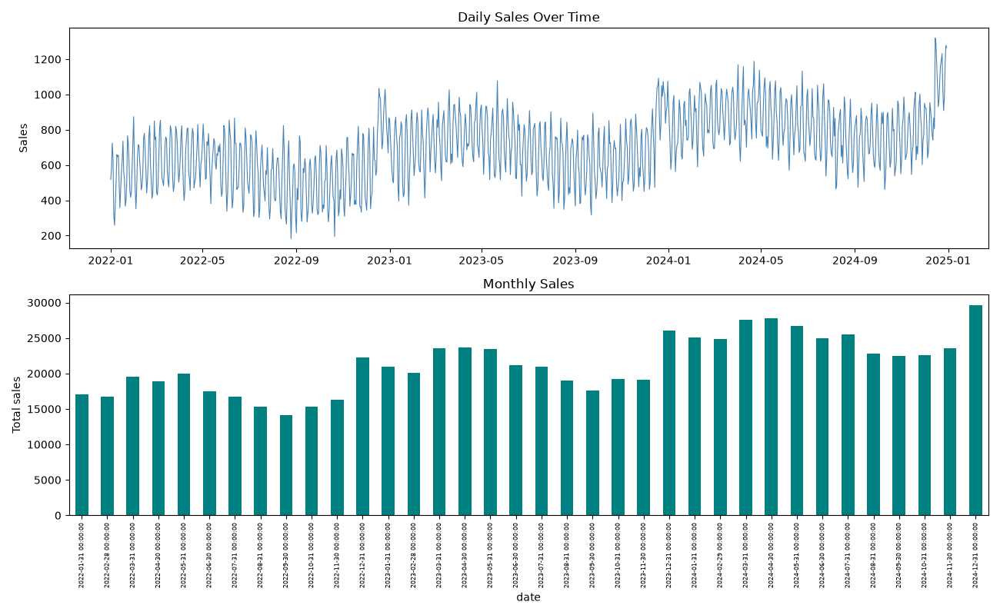
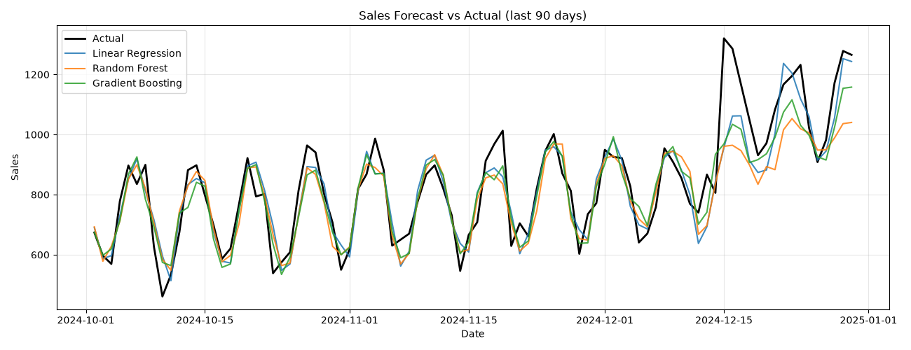
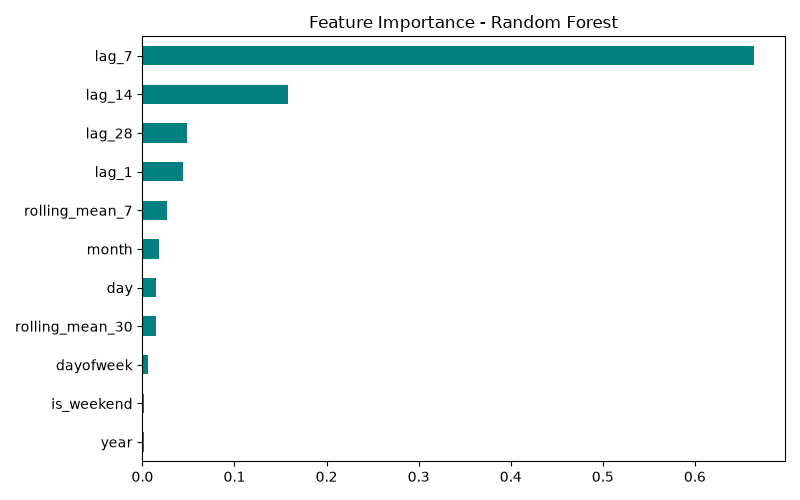

# 📈 Sales Forecasting & Predictive Analytics

[](https://www.python.org/)
[](https://scikit-learn.org/)
[](LICENSE)

Forecast daily sales from historical data using calendar features, lag variables and rolling
statistics. Complete pipeline: EDA → feature engineering → chronological split → model comparison.

## 🚀 Quick Start

```bash
pip install -r requirements.txt
python sales_forecasting.py
```
Plots are saved into `images/` automatically. Runs out of the box with realistic synthetic
retail data — to use a real sales dataset instead, uncomment the **Option B** block in
`sales_forecasting.py` (expects daily totals: `date`, `sales`).

## 🛠️ Pipeline
1. **EDA** — daily sales trend + monthly totals
2. **Feature engineering**
   - Calendar: `year`, `month`, `day`, `dayofweek`, `is_weekend`
   - Lag features: sales 1 / 7 / 14 / 28 days ago (momentum + weekly cycles)
   - Rolling means: 7-day and 30-day (trend)
3. **Split** — last 90 days = test set. **Never shuffled** — time series must stay chronological.
4. **Models** — Linear Regression · Random Forest · Gradient Boosting
5. **Evaluation** — MAE, RMSE, R²

## 📊 Results (synthetic data)
| Model | MAE | RMSE | R² |
|---|---|---|---|
| Linear Regression | 62.20 | 81.58 | 0.818 |
| Gradient Boosting | 66.27 | 85.90 | 0.799 |
| Random Forest | 74.53 | 100.66 | 0.724 |

## 🖼️ Plots




## 🔗 Dataset (real)
Kaggle → *Superstore Sales* or *Walmart Sales Forecasting* — group by date to get daily totals

## 📄 License
MIT — see [LICENSE](LICENSE). Part of my [ML portfolio](https://github.com/rajwardeep7-wq).
